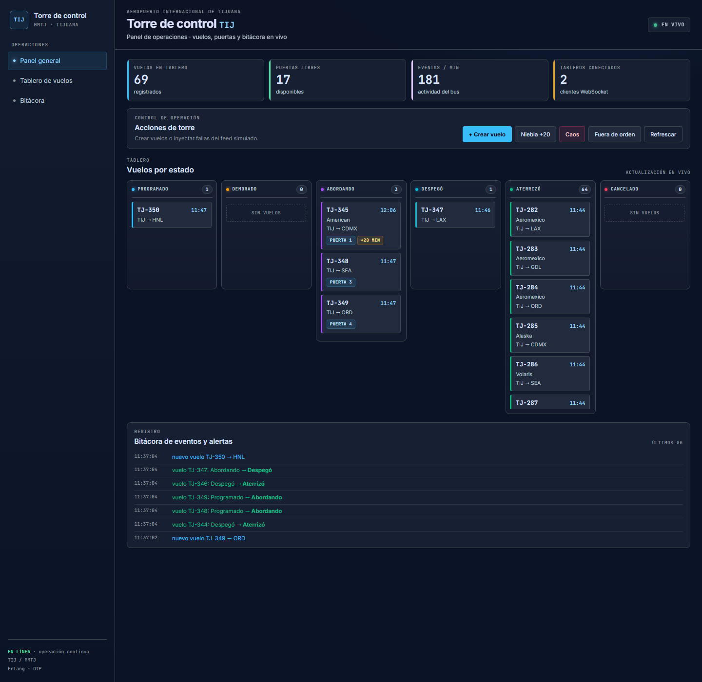
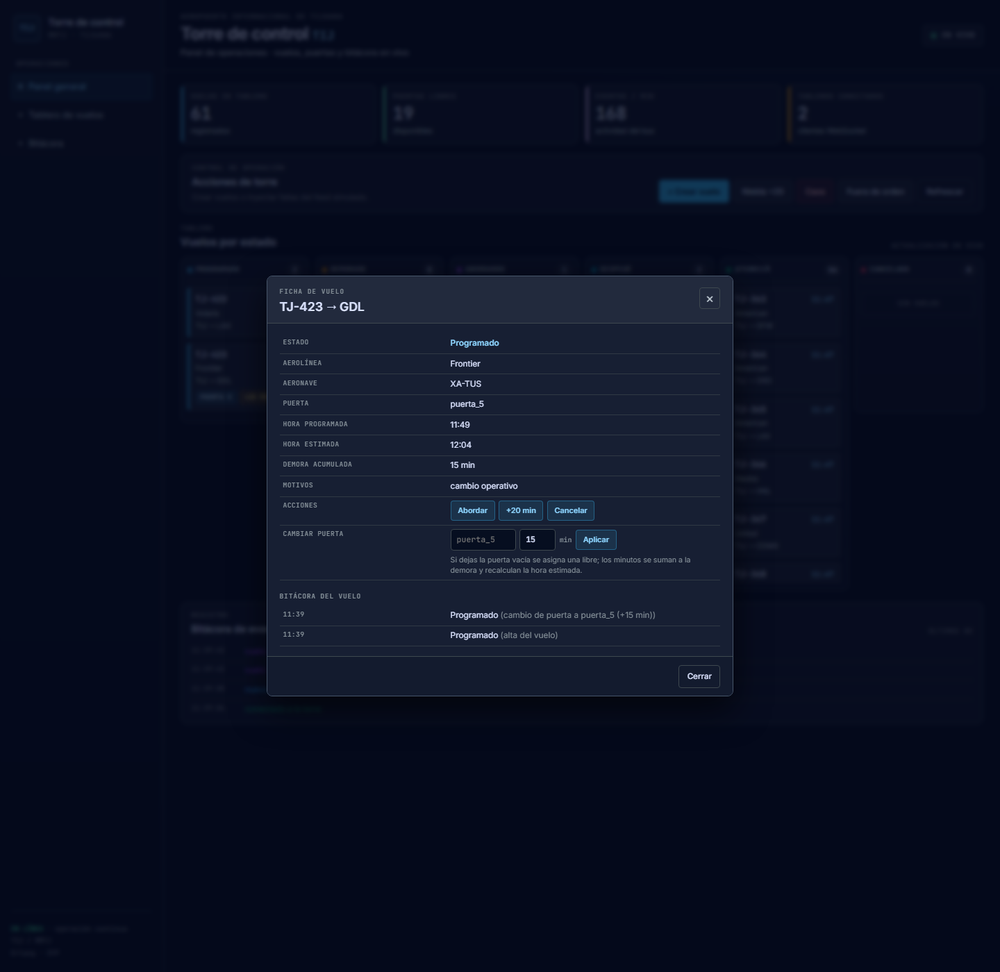

# Torre de control TIJ — Proyecto 22

| Materia | Programación Lineal |
|---|---|
| **Alumno** | Rodriguez Peraza Carlos Eliab |
| **No. de control** | 23212719 |
| **Grupo** | 2-3 |

Tablero de operaciones del Aeropuerto Internacional de Tijuana (TIJ / MMTJ)
construido en **Erlang/OTP 27** con **cowboy**. Cada vuelo es un proceso
`gen_statem` independiente, supervisado, con API HTTP, WebSocket en vivo,
persistencia en disco y un tablero web responsive.

---

## 1. Ejecutar

Requisitos: **Erlang/OTP 27 o superior** y **rebar3**. No se usa Node, Docker ni
base de datos externa.

```bash
rebar3 compile
rebar3 eunit
rebar3 shell
```

Abrir <http://localhost:8080>. La aplicación también puede ejecutarse como
release:

```bash
rebar3 release
_build/default/rel/p22_torre_de_control_tij/bin/p22_torre_de_control_tij foreground
```

---

## 2. Qué hace

- **Seis estados por vuelo:** `programado`, `demorado`, `abordando`, `despego`,
  `aterrizado`, `cancelado`.
- **Transiciones legales:** el `gen_statem` rechaza acciones fuera de orden; la
  API responde `409` y el tablero lo registra.
- **Cambio de puerta + hora en una sola operación:** conserva el estado actual,
  libera la puerta anterior y recalcula la hora estimada.
- **Cascada por aeronave:** un retraso puede propagarse a los vuelos siguientes
  de la misma aeronave.
- **Caos y recuperación:** se pueden matar procesos; el supervisor los
  reconstruye con su estado.
- **Reinicio de la VM:** respaldo en disco y recuperación de vuelos al arrancar.
- **Fuentes contradictorias y mensajes repetidos:** se detectan y se ignoran
  sin corromper el estado.
- **WebSocket:** snapshot inicial (`resync`) y eventos incrementales sin
  recargar el tablero.
- **Métricas:** `/metrics` con `recon` (procesos, memoria, puertas, clientes y
  eventos por minuto).

---

## 3. Diseño OTP

```text
p22_torre_de_control_tij_sup   (rest_for_one, 10 reinicios / 60 s)
├── p22_respaldo               gen_server  ETS + persistent_term + archivo
├── p22_eventos                gen_server  bus de eventos y suscripciones WS
├── p22_puertas                gen_server  asignador de 20 puertas
├── p22_vuelos_sup             supervisor  simple_one_for_one
│   └── p22_vuelo_statem × N   gen_statem  un proceso por vuelo
├── p22_feed                   gen_server  simulación, niebla y caos
└── p22_web                    gen_server  cowboy: API, tablero, WS, métricas
```

**`rest_for_one`:** el orden expresa dependencias. Los vuelos necesitan el
respaldo, el bus y las puertas; la web necesita el bus. Si cae `p22_respaldo`,
se reinicia todo lo que depende de él y cada vuelo relee su estado. Si solo cae
`p22_web`, los vuelos no se tocan.

**`simple_one_for_one`:** el número de vuelos cambia durante el día. Todos
comparten módulo y arranque; al ser `permanent`, un vuelo muerto se reconstruye
sin reiniciar a los demás.

**Un proceso por vuelo:** las reglas del ciclo de vida quedan aisladas. Una
transición ilegal se rechaza en el `gen_statem`, no en el handler HTTP, y la
caída de un vuelo no afecta al resto del tablero.

**Dónde vive el estado:**

1. El `gen_statem` es la verdad en caliente.
2. Antes de publicar cada cambio, `p22_respaldo:guardar_vuelo/3` lo escribe en
   ETS y en `persistent_term`, que sobreviven a la caída del proceso.
3. Con `persistir = true`, también se escribe en `data/p22_respaldo.bin`, que
   sobrevive al reinicio de la VM. Al arrancar, el feed crea un proceso por
   cada vuelo guardado.

La API y el WebSocket consultan al proceso; si está entre reinicios, responden
con la imagen del respaldo (`de_respaldo: true`). Por eso el tablero no
parpadea.

---

## 4. API

| Método | Ruta | Uso |
|---|---|---|
| `GET` | `/` | Tablero web |
| `GET` | `/api/vuelos` | Lista de vuelos |
| `POST` | `/api/vuelos` | Crea un vuelo de demostración |
| `GET` | `/api/vuelos/:id` | Detalle e historial |
| `POST` | `/api/vuelos/:id/estado` | Aplica una transición |
| `POST` | `/api/demo/:accion` | `niebla`, `caos`, `fuera_de_orden`, `pausar`, `reanudar` |
| `GET` | `/ws` | WebSocket del tablero |
| `GET` | `/metrics` | Métricas y estado del sistema |

Ejemplo de cambio de puerta y demora:

```bash
curl -X POST localhost:8080/api/vuelos/7/estado \
  -H 'content-type: application/json' \
  -d '{"accion":"cambiar_puerta","fuente":"torre","puerta":"puerta_5","minutos":15,"motivo":"cambio operativo"}'
```

---

## 5. Pruebas

```bash
rebar3 eunit
```

Resultado verificado en WSL2/Ubuntu con OTP 27 y rebar3 3.26.0:

```text
31 tests, 0 failures
```

Las pruebas cubren transiciones ilegales, mensajes fuera de orden, fuentes
contradictorias, cascada por aeronave, caos, reinicio, cambio de puerta y
asignación de puertas.

También se ejecutó una prueba local de **300 clientes WebSocket**:
300/300 conectados, 0 fallos y 300 `resync` iniciales. El detalle y las cifras
están en [`docs/CARGA_300.md`](docs/CARGA_300.md).

---

## 6. Prueba de caos

En `test/p22_caos_tests.erl`:

| Qué se mató | Qué se esperaba | Qué ocurrió |
|---|---|---|
| Vuelo 808 en `abordando` | PID nuevo, mismo estado y misma puerta; respaldo igual | Pasó: PID distinto, `abordando`, puerta conservada |
| Vuelo 809 en `demorado` (30 min, motivo `niebla`) | Recuperar los 30 min y el motivo | Pasó: estado, demora y motivo conservados |
| 5 vuelos (701–705) en serie | El bus y el árbol siguen vivos; los 5 vuelven | Pasó: `pong`, puertas y respaldo vivos, 5 vuelos en `programado` |

En vivo, `POST /api/demo/caos` mató el vuelo 7 cuando estaba en `despego`; el
log mostró **una sola** reconstrucción y el vuelo siguió operando. No hubo
bucle de reinicios.

---

## 7. Supuestos y cifras

Del enunciado, tomadas como **órdenes de magnitud** y no verificadas contra una
fuente externa:

- TIJ con **una sola pista**, ~**120 vuelos/día** y picos de **10
  movimientos/hora**.
- **300 clientes** viendo el tablero.
- Niebla matutina que demora **20 min** todas las salidas.
- Un vuelo que cambia de puerta y de hora a la vez.

Supuestos propios:

- **20 puertas** (configurable) y un máximo de **14 vuelos vivos** en la
  simulación.
- La **pista no se modela como recurso separado**; para este alcance bastan la
  puerta y el turno de despegue.
- Los vuelos son **simulados**: no se consumen OpenSky, AviationStack ni el FIDS.
- El tiempo de la demo está **comprimido** (tick de 2 s).
- La **torre** tiene la última palabra: una vez que fija un estado, la aerolínea
  o el sistema no lo revierten.
- Los estados reales se agrupan en **6 estados** operativos.

Cifras verificadas en esta implementación:

- **31 pruebas, 0 fallos** con `rebar3 eunit` en WSL2/Ubuntu, OTP 27 y rebar3
  3.26.0.
- **300/300** clientes WebSocket conectados, **0 fallos** y **300 `resync`**
  iniciales.
- **24 600 mensajes** entregados en 20 s (82 por cliente).
- Handshake **p95 de 97.6 ms** (máximo 132.7 ms).
- Memoria: **58.8 MB** con 300 clientes y 411 procesos; **40.6 MB** y 120
  procesos al desconectarse.
- Reinicio del nodo: **65 vuelos recuperados** desde
  `data/p22_respaldo.bin`, conservando identificación, destino e historial.

El detalle de la carga está en [`docs/CARGA_300.md`](docs/CARGA_300.md).

---

## 8. Interfaz

El tablero adopta el sistema de diseño exportado de **Google Stitch**:
superficies oscuras, tipografía Inter/JetBrains Mono, barra lateral, KPIs,
seis columnas por estado y modal de detalle con **Cambiar puerta**.





La vista móvil está en
[`design/capturas/tablero-movil.png`](design/capturas/tablero-movil.png).

- Sistema de diseño implementado: [`design/DESIGN.md`](design/DESIGN.md)
- Índice de capturas: [`design/CAPTURAS.md`](design/CAPTURAS.md)
- Mockups y ZIP de Stitch: [`design/stitch/`](design/stitch/)

---

## 9. Documentación

- **Manual de uso:** [`docs/GUIA_USO.md`](docs/GUIA_USO.md) — también publicado
  como Gist: <https://gist.github.com/CarlosEliab/da48ed12e3fbec9f22077040b8227f8d>
- **Montaje en VM y despliegue:** [`docs/VM_Y_DESPLIEGUE.md`](docs/VM_Y_DESPLIEGUE.md)
- **Prueba de carga:** [`docs/CARGA_300.md`](docs/CARGA_300.md)
- **Diseño UIX:** [`design/DESIGN.md`](design/DESIGN.md)

La unidad systemd de ejemplo está en
[`deploy/p22-torre-de-control-tij.service`](deploy/p22-torre-de-control-tij.service).

---

## 10. Estructura

```text
src/            módulos OTP, handlers cowboy, gen_statem y persistencia
test/           pruebas EUnit
priv/           tablero web (index.html)
config/         sys.config y vm.args
design/         sistema de diseño, capturas y mockups de Stitch
docs/           manual, despliegue y prueba de carga
deploy/         unidad systemd
scripts/        cliente de prueba de carga WebSocket
```

---

## 11. Notas

- La prueba de 300 clientes se hizo en loopback local, no a través de Internet
  ni TLS; el detalle está en `docs/CARGA_300.md`.
- La interfaz se verificó a 1440 px y 390 px en Chrome; no se probó en un
  teléfono físico.
- La unidad systemd se incluye como plantilla para la VM final.
