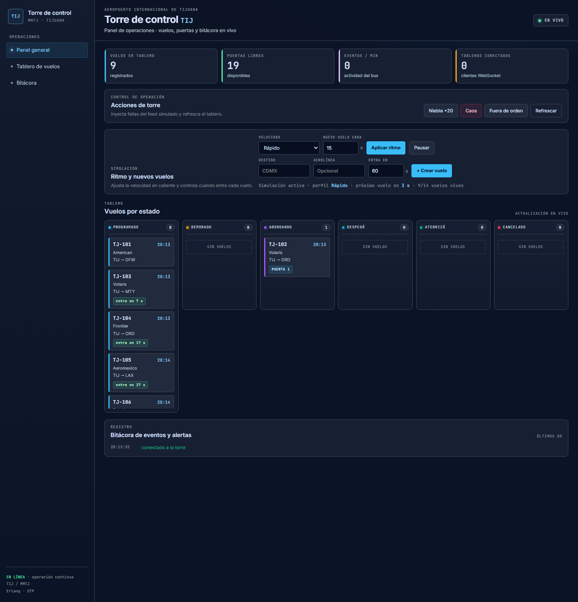
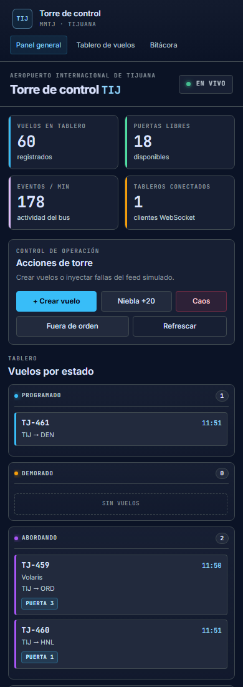

# Torre de control TIJ — Proyecto 22

* **Escuela:** Instituto Tecnológico de Tijuana
* **Materia:** Programación Lógica y Funcional
* **Docente:** René Solís Reyes
* **Horario:** 2:00 pm a 3:00 pm
* **Alumno:** Rodriguez Peraza Carlos Eliab
* **No. de control:** 23212719
* **Grupo:** 2-3

**Repositorio:** <https://github.com/CarlosEliab/p22-torre-de-control-tij-entrega>  
**Gist / manual:** <https://gist.github.com/CarlosEliab/da48ed12e3fbec9f22077040b8227f8d>

---

### El problema

Mantener un tablero confiable del estado de cada vuelo del Aeropuerto
Internacional de Tijuana (TIJ / MMTJ), aceptar solo transiciones legales,
resolver mensajes contradictorios o fuera de orden, propagar demoras por
aeronave y reconstruir el estado si un proceso o la máquina virtual se caen.

El aeropuerto opera con una sola pista y un flujo constante de vuelos. Pasajeros,
aerolíneas y personal en tierra necesitan ver el mismo estado en tiempo real, sin
que dos fuentes (torre y aerolínea) dejen el tablero inconsistente.

## 1. Propósito del sistema

Mantener un tablero de operaciones en tiempo real donde **cada vuelo es un
proceso Erlang independiente** (`gen_statem`), supervisado, con API HTTP,
WebSocket, bitácora de eventos, persistencia en disco y un panel web responsive.

El sistema permite:

- Consultar los vuelos por estado: `programado`, `demorado`, `abordando`,
  `despegó`, `aterrizado` y `cancelado`.
- Aplicar transiciones manuales desde el tablero (la torre “es” el usuario).
- Cambiar puerta y hora estimada en una sola operación.
- Inyectar fallas del mundo real: niebla, mensajes fuera de orden y caos
  (muerte de procesos).
- **Ajustar la velocidad de la simulación en caliente**, sin reiniciar el
  servidor, y decidir en cuántos segundos entra cada vuelo nuevo.
- Recuperar el estado después de un reinicio del nodo o de la VM.

**Usuario cliente:** operador de la torre de control (monitoreo y control) y
pasajeros/aerolíneas (consulta del tablero).

## 2. Tecnologías

| Capa | Tecnología |
|---|---|
| Backend | Erlang/OTP 27, `gen_statem`, `gen_server`, supervisores OTP |
| Servidor web | Cowboy 2.12 (HTTP + WebSocket) |
| Interfaz | HTML, CSS y JavaScript en un solo archivo (`priv/index.html`), diseño original en Google Stitch |
| Persistencia | Tablas ETS + archivo `data/p22_respaldo.bin` |
| Ejecución | `rebar3 shell`, release de relx y servicio `systemd` en AWS (Ubuntu) |
| Pruebas | EUnit (`rebar3 eunit`) |
| Monitoreo | `recon`, `GET /metrics` y `GET /health` |

## 3. Diseño OTP

### Árbol de supervisión

```
p22_torre_de_control_tij_sup          (rest_for_one)
├── p22_respaldo                      ETS + persistencia en disco
├── p22_eventos                       bus de eventos + WebSocket + contadores
├── p22_puertas                       asignador de puertas (recurso compartido)
├── p22_vuelos_sup                    (simple_one_for_one)
│   └── p22_vuelo_statem × N          un proceso por vuelo
├── p22_feed                          simulación configurable
└── p22_web                           Cowboy: API, tablero, WebSocket y métricas
```

El orden importa: con `rest_for_one`, si `p22_respaldo` o `p22_eventos` mueren,
se reinician también los procesos que dependen de ellos. Así los vuelos nunca
arrancan sin respaldo, bus o asignador de puertas.

### Quién reinicia a quién y por qué

| Decisión | Justificación |
|---|---|
| **Un `gen_statem` por vuelo** | Los mensajes de un vuelo se atienden de uno en uno. Dos transiciones simultáneas no pueden ganar las dos |
| **Supervisor dinámico `simple_one_for_one`** | El número de vuelos cambia todo el tiempo; el supervisor no conoce la lista en compilación |
| **Raíz con `rest_for_one`** | El respaldo y el bus son dueños de estado compartido; si mueren, sus dependientes deben reiniciarse |
| **Estado guardado fuera del vuelo** | Al morir un proceso, el supervisor lo reinicia y `init/1` recupera el último estado desde ETS/disco |
| **Un asignador de puertas** | La puerta es un recurso finito: una sola operación decide quién la toma y evita dobles asignaciones |
| **Lecturas desde ETS** | Listar vuelos y métricas no bloquea a los procesos de vuelo |
| **Persistencia en disco** | Un reinicio de la VM no borra la operación: los vuelos se reconstruyen al arrancar |

### Casos difíciles del problema

| Caso | Cómo se resuelve |
|---|---|
| **Mensaje fuera de orden** | Cada fuente lleva una secuencia (`fuente_seq`). Si llega una secuencia vieja, el `gen_statem` la ignora y publica `evento_ignorado` |
| **Dos fuentes contradicen el estado** | Se aplica una regla de autoridad: la torre manda sobre la aerolínea; la aerolínea no puede “deshacer” una decisión de la torre |
| **Transición ilegal** | La tabla `legal/1` del `gen_statem` la rechaza por diseño. La API responde `409` y el tablero lo registra |
| **Cambio de puerta + hora** | Es una sola operación atómica: conserva el estado, libera la puerta anterior, asigna la nueva y recalcula la hora estimada |
| **Efecto cascada por aeronave** | Si se cancela un vuelo, el `p22_feed` busca el vuelo de regreso de la misma matrícula y lo cancela |
| **Caos (muere un proceso)** | El supervisor lo reinicia con sus mismos argumentos; `init/1` lo re-entra en el último estado conocido sin que el tablero parpadee |
| **Reinicio de la VM** | `p22_respaldo` escribe una foto en `data/p22_respaldo.bin`; al arrancar, el feed re-crea un proceso por cada vuelo guardado |
| **Cientos de clientes** | El tablero lee snapshots de ETS y recibe cambios por WebSocket; no se consulta a cada vuelo por cada cliente |

### Estados y transiciones de un vuelo

```
programado ──empezar_abordaje──> abordando ──despegar──> despegó ──aterrizar──> aterrizado
     │                              │
     ├──demorar──> demorado         └──cancelar──> cancelado
     │                 │
     │                 ├──empezar_abordaje──> abordando
     │                 └──fin_demora──> programado
     └──cancelar──> cancelado
```

| Estado | Acciones legales |
|---|---|
| `programado` | `empezar_abordaje`, `demorar`, `cambiar_puerta`, `cancelar` |
| `demorado` | `empezar_abordaje`, `fin_demora`, `cambiar_puerta`, `cancelar` |
| `abordando` | `despegar`, `cambiar_puerta`, `cancelar` |
| `despegó` | `aterrizar` |
| `aterrizado` | terminal: todo se rechaza con explicación |
| `cancelado` | terminal: todo se rechaza con explicación |

### Simulación configurable

El simulador (`p22_feed`) crea vuelos, los avanza por transiciones legales,
inyecta demoras y caos, y respeta el **tiempo de permanencia** de cada estado.
La velocidad se cambia en caliente desde el tablero o la API.

| Perfil | Tick | Vuelo nuevo | Entrada | Abordaje | Vuelo |
|---|---:|---:|---:|---:|---:|
| **Muy lento** | 20 s | 120 s | 90 s | 60 s | 150 s |
| **Lento** (default) | 15 s | 90 s | 60 s | 60 s | 120 s |
| **Normal** | 8 s | 45 s | 45 s | 40 s | 90 s |
| **Rápido** | 3 s | 15 s | 15 s | 12 s | 30 s |
| **Personalizado** | el actual | el que definas | fijo | fijo | fijo |

- `nuevo_vuelo_cada_ms`: cada cuánto se crea un vuelo automático.
- `espera_entrada_ms`: tiempo en `programado` antes de poder abordar.
- `abordaje_ms`: tiempo en `abordando` antes de despegar.
- `vuelo_ms`: tiempo en `despegó` antes de aterrizar.
- `entrada_seg` (al crear un vuelo): retrasa su entrada N segundos.
- `hora_programada` (Unix, segundos): fija la hora exacta de entrada.

Un vuelo **no avanza antes de su `hora_programada`**. Esto evita que los vuelos
nazcan y aterricen en pocos segundos cuando la simulación está en `Lento`.

## 4. Requisitos y acceso

- **Erlang/OTP 27 o superior** y **rebar3**. No se usa Node, Docker ni base de
  datos externa.
- Puerto **8080** abierto en el *Security Group* de AWS (entrada TCP).
- Acceso local: <http://localhost:8080>
- Acceso en AWS: `http://<IP-PUBLICA-DE-LA-VM>:8080`

> La guía completa de AWS está en [`docs/AWS.md`](docs/AWS.md). Para una VM
> Ubuntu también puedes usar [`deploy/instalar_servicio.sh`](deploy/instalar_servicio.sh).

## 5. Instalación

```bash
git clone https://github.com/CarlosEliab/p22-torre-de-control-tij-entrega.git
cd p22-torre-de-control-tij-entrega
rebar3 compile
rebar3 eunit
```

Resultado esperado de las pruebas:

```text
Finished in ...
33 tests, 0 failures
```

## 6. Ejecución

### Desarrollo

```bash
rebar3 compile
rebar3 eunit
rebar3 shell
```

Al iniciar se muestra el listener de Cowboy en el puerto **8080**. Abre la
dirección del punto 4 y verifica que el indicador de la esquina superior derecha
diga **En vivo**.

### Release

```bash
rebar3 release
_build/default/rel/p22_torre_de_control_tij/bin/p22_torre_de_control_tij foreground
```

### Servicio en AWS (systemd)

```bash
# desde la raíz del proyecto, en la VM
sudo ./deploy/instalar_servicio.sh
systemctl status p22-torre-de-control-tij
journalctl -u p22-torre-de-control-tij -f
```

Para empaquetar el proyecto y subirlo por `scp`:

```bash
./deploy/empaquetar.sh
# genera dist/p22-torre-de-control-tij.tar.gz sin _build/ ni data/
```

## 7. Manual de uso

### Panel principal

1. La barra superior muestra el estado de la conexión WebSocket (**En vivo**).
2. Los indicadores resumen vuelos, puertas libres, eventos por minuto y
   tableros conectados.
3. El tablero agrupa los vuelos en seis columnas por estado.
4. Cada tarjeta muestra identificación, aerolínea, destino, puerta, demora y,
   si el vuelo aún no entra, una etiqueta **“entra en N s/min”**.

### Panel de simulación

| Control | Uso |
|---|---|
| **Velocidad** | `Muy lento`, `Lento`, `Normal`, `Rápido` o `Personalizado` |
| **Nuevo vuelo cada X s** | Intervalo entre altas automáticas (solo se aplica con perfil personalizado) |
| **Aplicar ritmo** | Cambia el ritmo en caliente, sin reiniciar |
| **Pausar / Reanudar** | Congela o reactiva la simulación |
| **Crear vuelo** | Alta manual con destino, aerolínea y **“entra en X s”** |

El indicador inferior muestra el perfil activo, el próximo vuelo automático y
cuántos vuelos vivos hay respecto al máximo.

### Detalle de un vuelo

Al pulsar una tarjeta se abre la ficha con:

- Estado actual, aerolínea, aeronave y puerta.
- Hora programada, hora estimada y demora acumulada.
- Botones con las **transiciones legales** de ese estado.
- **Cambio de puerta + minutos de demora** en una sola operación.
- Bitácora del vuelo con los últimos movimientos.

### Bitácora de eventos

Registro cronológico de altas, cambios de estado, cambios de puerta, caos,
eventos ignorados por secuencia vieja y alertas de niebla.

### Acciones de torre

| Botón | Efecto |
|---|---|
| **Niebla +20** | Demora 20 minutos todos los vuelos programados |
| **Caos** | Mata un proceso de vuelo al azar para validar la reconstrucción |
| **Fuera de orden** | Envía una secuencia vieja que debe ignorarse |
| **Refrescar** | Vuelve a cargar el tablero desde la API |

## 8. Ejemplos de API

Este apartado permite usar el sistema sin la interfaz, desde una terminal.

```bash
# Tablero y métricas
curl -s localhost:8080/api/vuelos | head -c 400
curl -s localhost:8080/metrics
curl -s localhost:8080/health

# Estado de la simulación
curl -s localhost:8080/api/simulacion

# Cambiar a perfil lento (por defecto)
curl -s -X POST localhost:8080/api/simulacion/ritmo \
  -H 'content-type: application/json' -d '{"perfil":"lento"}'

# Cambiar solo el intervalo entre vuelos nuevos (personalizado)
curl -s -X POST localhost:8080/api/simulacion/ritmo \
  -H 'content-type: application/json' -d '{"nuevo_vuelo_cada_seg":120}'

# Pausar y reanudar
curl -s -X POST localhost:8080/api/simulacion/pausar
curl -s -X POST localhost:8080/api/simulacion/reanudar

# Crear un vuelo que entra en 90 segundos
curl -s -X POST localhost:8080/api/vuelos \
  -H 'content-type: application/json' \
  -d '{"destino":"CDMX","aerolinea":"Volaris","entrada_seg":90}'

# Aplicar una transición legal
curl -s -X POST localhost:8080/api/vuelos/1/estado \
  -H 'content-type: application/json' -d '{"accion":"empezar_abordaje"}'

# Transición ilegal: responde 409
curl -s -i -X POST localhost:8080/api/vuelos/1/estado \
  -H 'content-type: application/json' -d '{"accion":"aterrizar"}'

# Escenarios de demo
curl -s -X POST localhost:8080/api/demo/niebla
curl -s -X POST localhost:8080/api/demo/caos
curl -s -X POST localhost:8080/api/demo/fuera_de_orden
```

| Ruta | Método | Descripción |
|---|---|---|
| `/api/vuelos` | GET | Lista completa de vuelos |
| `/api/vuelos` | POST | Crea un vuelo (`destino`, `aerolinea`, `entrada_seg`, `hora_programada`) |
| `/api/vuelos/:id` | GET | Detalle con historial |
| `/api/vuelos/:id/estado` | POST | Aplica una transición legal |
| `/api/simulacion` | GET | Perfil, pausa, tiempos y vuelos vivos |
| `/api/simulacion/ritmo` | POST | Cambia perfil y/o tiempos |
| `/api/simulacion/pausar` | POST | Pausa el feed |
| `/api/simulacion/reanudar` | POST | Reanuda el feed |
| `/api/demo/:accion` | POST | `niebla`, `caos`, `fuera_de_orden`, `pausar`, `reanudar` |
| `/metrics` | GET | Métricas para monitoreo |
| `/health` | GET | Sonda simple para AWS/systemd |
| `/ws` | WebSocket | Cambios en tiempo real |

## 9. Supuestos y cifras verificadas

**Supuestos propios**

- El aeropuerto tiene **20 puertas** físicas (`puertas_total`).
- Se mantienen como máximo **14 vuelos vivos** a la vez (`max_vuelos_vivos`).
- El escenario del problema habla de **120 vuelos por día** con picos de
  **10 movimientos por hora**.
- Los vuelos iniciales se siembran escalonados (0, 10, 20, … segundos) para que
  no todos entren al mismo tiempo.
- El perfil por defecto es **Lento**; el operador puede cambiarlo en caliente.
- La hora programada se maneja en **segundos Unix**; los tiempos de simulación
  se manejan en **milisegundos**.
- Un vuelo `programado` no avanza hasta que llega su `hora_programada`.
- Las transiciones del feed se emiten como fuente `torre`; la aerolínea no
  puede imponerse sobre una decisión de la torre.

**Cifras verificadas**

| Prueba | Resultado |
|---|---|
| `rebar3 compile` | compila sin warnings |
| `rebar3 eunit` | **33 tests, 0 failures** |
| `GET /`, `/api/vuelos`, `/metrics` | `200` |
| `GET /api/simulacion` | `200` con perfil y tiempos |
| Cambio de perfil en caliente | se refleja sin reiniciar |
| `POST /api/vuelos` con `entrada_seg` | el vuelo queda `programado` hasta su hora |
| Pausar / reanudar | no se duplican ticks |
| `rebar3 release` | release ensamblado |
| Reinicio del nodo | recupera vuelos desde `data/p22_respaldo.bin` |

## 10. Diseño de la interfaz (Google Stitch)

La interfaz se diseñó en Google Stitch con el prompt de
[`design/PROMPT_STITCH.md`](design/PROMPT_STITCH.md): dashboard en modo oscuro,
columnas por estado, ficha de vuelo y bitácora de eventos. La versión final se
redujo y se conectó al backend real para evitar saturación de datos y mantener
legible el tablero en escritorio y celular.

### Interfaz creada con Stitch


### Versión final conectada al backend



## 11. Evidencias

### 1. Tablero con vuelos por estado


### 2. Panel de simulación configurable

El selector de velocidad, el intervalo entre vuelos, la pausa y el alta con
`entrada_seg` están en la misma pantalla del tablero.


### 3. Detalle y cambio de puerta + hora


### 4. Tablero en celular



### 5. Resultado de `rebar3 eunit`

```text
===> Performing EUnit tests...
Finished in 12.6 seconds
33 tests, 0 failures
```

### 6. Prueba de caos

El botón **Caos** mata un proceso de vuelo al azar. El supervisor lo reinicia,
`init/1` recupera el último estado desde el respaldo y el tablero no pierde la
tarjeta. El evento aparece en la bitácora como `caos`.

### 7. Carga de 300 clientes

El procedimiento y los resultados están en [`docs/CARGA_300.md`](docs/CARGA_300.md).

## 12. Solución de problemas

| Problema | Causa probable | Solución |
|---|---|---|
| La página no abre desde mi computadora | Puerto 8080 cerrado en AWS | Agregar regla de entrada TCP 8080 en el Security Group |
| El indicador dice **Reconectando** | El servidor no está corriendo o cambió el puerto | Verifica `rebar3 shell` y abre la IP/puerto correctos |
| Los vuelos se mueven muy rápido | Perfil `Rápido` o `Normal` | Selecciona **Lento** o **Muy lento**, o sube “Nuevo vuelo cada X s” |
| Un vuelo no avanza | Su `hora_programada` aún no llega | Revisa la etiqueta “entra en N s” o crea el vuelo con `entrada_seg` menor |
| `rebar3 eunit` falla por timeout | Hay un proceso viejo usando el puerto | Cierra otras instancias y vuelve a ejecutar |
| Error al compilar | Falta Erlang/OTP 27 o una dependencia | Instala OTP 27+ y ejecuta `rebar3 compile` de nuevo |
| Un botón responde “transición rechazada” | La acción no es legal en ese estado (409) | Es normal: actualiza y usa una acción permitida |
| Aparece un *SUPERVISOR REPORT* en las pruebas | Es la prueba de recuperación que mata un proceso a propósito | No es un error: debe terminar con `0 failures` |
| Al reiniciar se pierden los vuelos | `persistir` está en `false` o falta `data/` | Activa `{persistir, true}` y verifica permisos de `data/` |
| El release no arranca en la VM | Faltan bibliotecas de OTP o el `-config` es incorrecto | Sigue [`docs/AWS.md`](docs/AWS.md) y no agregues `-config` en `vm.args` |

## 13. Conclusión personal

Al desarrollar este proyecto aprendí a modelar un problema de concurrencia real
con Erlang/OTP. Cada vuelo es un proceso independiente y supervisado: si uno
falla, el sistema no se detiene; el supervisor lo reinicia y recupera su último
estado desde el respaldo. Esa separación entre el estado del vuelo, el bus de
eventos y el asignador de puertas fue la parte más valiosa del diseño.

También entendí la importancia de las reglas explícitas: una máquina de estados
que rechaza transiciones ilegales evita muchos errores que en otros lenguajes se
corrigen “a mano”. Los casos difíciles del problema (mensajes fuera de orden,
fuentes contradictorias, efecto cascada y caos) se volvieron manejables al
separarlos en procesos y reglas pequeñas.

En la parte visual, integrar HTML, CSS y JavaScript en un solo archivo facilitó
la distribución en un servidor ligero como Cowboy. El tablero usa `fetch()` y
WebSocket para actualizarse sin recargar, y el panel de simulación permite
explicar la operación en vivo sin tocar el código. Finalmente, preparar el
release y el servicio `systemd` me mostró cómo llevar el proyecto a una VM en
AWS y dejarlo funcionando de forma reproducible.

---

## Anexos

| Documento | Contenido |
|---|---|
| [`docs/GUIA_USO.md`](docs/GUIA_USO.md) | Manual de uso y API |
| [`docs/VM_Y_DESPLIEGUE.md`](docs/VM_Y_DESPLIEGUE.md) | Despliegue general en VM |
| [`docs/AWS.md`](docs/AWS.md) | Guía paso a paso para AWS EC2 |
| [`docs/DEMO_Y_RUBRICA.md`](docs/DEMO_Y_RUBRICA.md) | Guion de demo y rúbrica |
| [`docs/CARGA_300.md`](docs/CARGA_300.md) | Prueba de carga con 300 clientes |
| [`docs/TRASPASO.md`](docs/TRASPASO.md) | Bitácora técnica y decisiones de implementación |
| [`problema/readme.md`](problema/readme.md) | Enunciado original del problema |
| [`design/DESIGN.md`](design/DESIGN.md) | Decisiones de interfaz |
